<p align="center">
  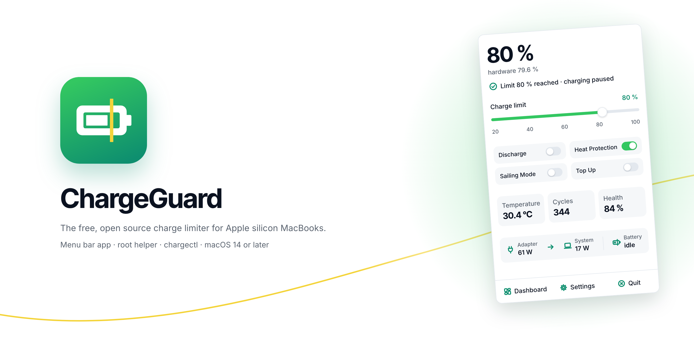
</p>

<p align="center">
  <a href="#features">Features</a> •
  <a href="#install">Install</a> •
  <a href="#build-from-source">Build</a> •
  <a href="#chargectl">chargectl</a> •
  <a href="#safety">Safety</a> •
  <a href="#screenshots">Screenshots</a>
</p>

<p align="center">
  
  
  
  
  
  
  
</p>

> [!WARNING]
> **In development, no release yet.** ChargeGuard builds and passes its unit tests on a MacBook Air M2
> (macOS 15.5). On that Mac the Charge Limiter has held the battery at 80 % through a 30-minute test, with
> `CHTE` blocking charging the whole time. The other features are still being verified on hardware, phase
> by phase. Until a release, try the interface safely with `make run-sim`. Progress is tracked in
> [`docs/PLAN.md`](docs/PLAN.md) and [`docs/TEST-CHECKLIST.md`](docs/TEST-CHECKLIST.md).

ChargeGuard is a battery-care menu bar app for Apple silicon MacBooks. Charging to 100 % every day is what
wears a battery out, so ChargeGuard holds the charge at a limit you choose, discharges to that limit while
plugged in, pauses charging when the battery runs hot, calibrates the battery, runs schedules, and exposes
everything to the Shortcuts app. A small root helper enforces the limit even while the app is closed.

It's free and open source, with no tiers and no paywall: every feature is included.

<p align="center">
  <picture>
    <source media="(prefers-color-scheme: dark)" srcset="docs/screenshots/overview-dark.png">
    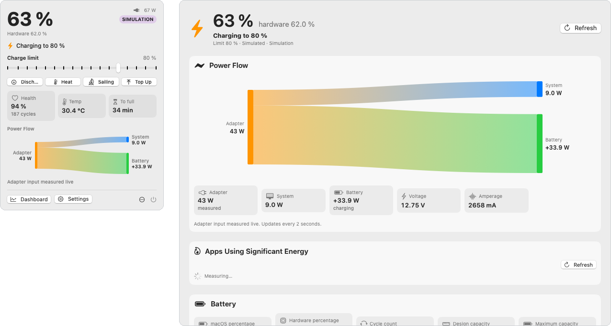
  </picture>
</p>

## Features

### Charge control

| Feature | What it does |
|---|---|
| **Charge Limiter** | Limit from 20 to 100 % (5 % steps, 1 % steps in Advanced). Charging stops at the limit and resumes below limit − 2 % (or the sailing range). |
| **Discharge** | Run from the battery while plugged in until the limit, then hold. Only while the Mac is awake. |
| **Automatic Discharge** | Discharge to the limit whenever the battery is above it while plugged in. |
| **Discharge in Clamshell Mode** | Keep discharging with the lid closed and an external display. |
| **Sailing Mode** | After reaching the limit, run from the adapter until the battery falls by the sailing range (1 to 20 %, default 5 %). |
| **Top Up** | Charge to 100 % once, with an estimated time remaining. |
| **Stop Charging when Sleeping** | Block charging just before sleep, since nothing can enforce the limit while asleep. |
| **Stop Charging when App Closed** | Keep enforcing with the helper (default) or restore normal charging when ChargeGuard quits. |

### Protection and maintenance

| Feature | What it does |
|---|---|
| **Heat Protection** | Pause charging at or above Max Temp (30 to 50 °C, default 35 °C) and resume 2 °C lower. It overrides everything else. |
| **Calibration Mode** | Charge to 100 % and hold, discharge to 15 %, charge to 100 % and hold, then restore the limit. Persistent, cancellable and schedulable. |

### Sleep and power

| Feature | What it does |
|---|---|
| **Disable Sleep until Charge Limit** | While plugged in and charging below the limit, keep the Mac from idle-sleeping. Released once the limit is reached. |
| **Sleep Control** | Keep awake for 30 minutes, 1, 2 or 4 hours, indefinitely or until the limit, optionally with the display on. |
| **Low Power Mode control** | Always off, always on, only on battery, or only on the adapter. |

### Automation

| Feature | What it does |
|---|---|
| **Schedule** | Weekly or one-off rules (start calibration, top up, set the limit, discharge on or off, Low Power Mode), with catch-up after sleep or boot when less than 2 hours late. |
| **Apple Shortcuts** | App Intents for status, limit, discharge, heat, sailing, top up, calibration, Low Power Mode, keep awake and the LED, with App Shortcuts phrases. |

### Insights

| Feature | What it does |
|---|---|
| **Power Flow** | A live Sankey diagram of adapter, system and battery power. |
| **Apps Using Significant Energy** | Top processes by energy (powermetrics, with fallbacks), with a Quit button. |
| **Stats** | Cycle count, capacities and health, temperature, voltage, amperage, time to full or empty, adapter and serial. |
| **Hardware Battery Percentage** | The raw percentage next to the macOS one. |

### Menu bar and system

| Feature | What it does |
|---|---|
| **Live Status Icons** | Charging, limit reached, discharging, heat paused, sailing, calibrating, top up, helper missing, error, and another tool running. |
| **Customizable menu bar icon and pop-up** | Icon styles, monochrome or coloured, percentage on or off, and a layout editor for the pop-up. |
| **Control MagSafe LED** | Green at the limit or while charging is blocked, orange while charging, off while discharging. System default when the setting is off. |
| **Fast User Switching** | The helper owns all state, and the app in an inactive session goes passive. |

Plus notifications, a Settings window, a Dashboard window, a first-run wizard, settings export and import,
a command-line tool and a `--simulate` mode.

## Install

There's no release yet; until the first one, [build from source](#build-from-source). Releases will work
like this.

**Requirements:** a MacBook with Apple silicon (Intel Macs show an "unsupported" screen) and macOS 14
Sonoma or later.

### Download

Download `ChargeGuard.dmg` from the [latest release](https://github.com/amir-codes/chargeguard/releases/latest),
open it and drag ChargeGuard to Applications.

ChargeGuard is open source but not notarized by Apple, because that needs a paid Developer ID. So macOS
asks once, the first time you open it:

1. Open ChargeGuard and close the warning.
2. Open **System Settings → Privacy & Security** and click **Open Anyway** next to ChargeGuard, then
   confirm with your password. The button shows for about an hour after the first attempt.

Or remove the download flag in Terminal instead: `xattr -dr com.apple.quarantine /Applications/ChargeGuard.app`

### Install from Terminal

```sh
curl -fsSL https://raw.githubusercontent.com/amir-codes/chargeguard/main/scripts/install.sh | bash
```

[`scripts/install.sh`](scripts/install.sh) downloads the latest release from GitHub, checks its checksum and
signature, copies ChargeGuard to /Applications and opens it. A download made with `curl` carries no
quarantine flag, so there's no warning to click through. It doesn't use sudo: the helper is installed later
from the app's first-run window. Read the script before running it; it's short.

Options: `CHARGEGUARD_VERSION=v1.0.0` installs a specific release, `CHARGEGUARD_DIR=~/Applications`
installs without an administrator account, and `CHARGEGUARD_OPEN=0` skips opening the app. Put them in
front of `bash`.

### Check a download

Each release has a `ChargeGuard.dmg.sha256` next to the DMG. With both in one folder:
`shasum -a 256 -c ChargeGuard.dmg.sha256`. Releases are built from this repository by the
[Release workflow](.github/workflows/release.yml) on a GitHub-hosted Mac, so every DMG traces back to a
public commit and a public build log.

## Build from source

```sh
git clone https://github.com/amir-codes/chargeguard.git
cd chargeguard
make run-sim          # try it first: simulated battery, no helper, no SMC writes
```

| Command | What it does |
|---|---|
| `make build` | `xcodegen generate` (when the project is missing or `project.yml` changed), then `xcodebuild` into `build/ChargeGuard.app` and `build/chargectl` |
| `make project` | Regenerate the Xcode project (after adding or removing source files) |
| `make test` | Unit tests: ChargeGuardCore (any platform with Swift) and ChargeGuardSystem (macOS) |
| `make run` | Build and open `build/ChargeGuard.app` |
| `make run-sim` | Open the app with `--simulate`: simulated battery, no helper, no SMC writes |
| `make install-helper` | Fallback helper install: `sudo scripts/install-helper.sh` (asks for your password) |
| `make uninstall` | `sudo scripts/uninstall.sh` (restores charging first) |
| `make dmg` | `build/ChargeGuard.dmg` |

To build from source you need Xcode 15.4 or later (Swift 5.10) and XcodeGen (`brew install xcodegen`).

Signing uses an Apple Development certificate when one is in the keychain, otherwise ad-hoc;
`make build IDENTITY=- TEAM=` forces ad-hoc, as releases do. The hardened runtime is on. The helper and `chargectl` are copied into `ChargeGuard.app/Contents/MacOS/`, and the launchd
plist into `Contents/Library/LaunchDaemons/`, before the app is signed. The `.xcodeproj` is generated from
`project.yml` and never committed. Only `make install-helper` and `make uninstall` use sudo.

## Installing the helper

The first-run window explains what the helper does, installs it, probes the SMC keys, shows the result and
asks for confirmation before it enables charge control. Until you confirm, nothing is written.

- **Primary path:** the app registers the helper with `SMAppService`. Approve it in **System Settings >
  General > Login Items**. Move ChargeGuard.app to /Applications first.
- **Fallback:** `sudo scripts/install-helper.sh /Applications/ChargeGuard.app` (or `make install-helper` for
  the build in `build/`). It copies the helper to `/Library/PrivilegedHelperTools/`, writes
  `/Library/LaunchDaemons/com.amir.chargeguard.helper.plist`, bootstraps it, and installs `chargectl` to
  `/usr/local/bin`. Use one path, not both: the script refuses to run while the SMAppService helper is
  loaded.

## How it works

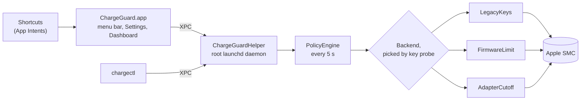

- **The helper is the enforcer.** It owns the configuration and state and runs the control loop every
  5 seconds. The app only edits settings and shows state, so the limit holds while the app is closed.
- **All feature logic is one pure function.** `PolicyEngine.evaluate(config, snapshot, previous, context)`
  returns a decision, and it is unit-tested in ChargeGuardCore.
- **Backends turn decisions into key writes.** They are chosen by probing which keys exist, never by macOS
  version or chip name, and they fail over at runtime (see [macOS 27 and firmware notes](#macos-27-and-firmware-notes)).
- **`--simulate`** runs the same controller in the app's own process on a simulated SMC and battery: no
  daemon, no root, no real keys.

## chargectl

```sh
chargectl status [--json] [--direct]  # state, backend, keys, conflicts (--direct: battery + key probe, no helper)
chargectl probe [--direct]            # every SMC key: present or absent, size, type, value
chargectl read KEY [--direct]         # read one key (e.g. CHTE)
chargectl restore [--direct]          # restore normal charging (--direct: sudo, without the helper)
chargectl limit N                     # set the charge limit (20-100)
chargectl discharge on|off
chargectl topup on|off
chargectl calibrate start [--fast] | stop
chargectl heat on|off
chargectl sailing on|off
chargectl lpm unmanaged|off|on|battery|adapter   # Low Power Mode policy
chargectl led system|state|off        # MagSafe LED: system default, show ChargeGuard's state, off
chargectl keepawake MINUTES [--display] | forever | off
chargectl enable | disable            # charge control on or off
chargectl events                      # recent helper events
chargectl writes                      # recent SMC writes with reasons
chargectl prepare-uninstall           # restore charging and stop enforcing (used by uninstall.sh)
chargectl version
```

Without `--direct`, every command talks to the helper over XPC, so the helper must be installed. `--direct`
reads work for any user.

## Safety

ChargeGuard writes only the SMC keys and values documented in [`docs/SMC-KEYS.md`](docs/SMC-KEYS.md), and
only keys a probe confirmed present. It never writes while another charging tool (AlDente, batt, the battery
CLI) is running. Every write is logged with its reason and a battery snapshot. Discharge never goes below
5 %, calibration never below 10 %, and Heat Protection overrides everything else.

Release builds are ad-hoc signed, so the helper can't pin its clients to a Team ID. It accepts only a validly
signed `com.amir.chargeguard` app or `chargectl` at the expected path, which is weaker than a Team ID check.
A Developer ID certificate would close that gap.

If charging looks wrong:

1. Menu bar pop-up → **Restore normal charging**, or `chargectl restore`.
2. Without the helper: `sudo chargectl restore --direct`.
3. A reboot resets every SMC charging key to the macOS default.
4. If the Mac never sleeps after a clamshell discharge with "Force the Mac awake during clamshell
   discharge" (Settings > Charging): `sudo pmset -a disablesleep 0`. A reboot does not clear this one.

[`docs/SAFETY.md`](docs/SAFETY.md) lists every state ChargeGuard can leave the Mac in and how to recover from
each.

## Uninstall

```sh
sudo scripts/uninstall.sh /Applications/ChargeGuard.app   # or: make uninstall
```

Without a path the script looks for `/Applications/ChargeGuard.app`, then `build/ChargeGuard.app`. It
restores normal charging first (through the helper, or directly), unregisters the SMAppService helper,
unloads and removes the fallback install, restores `pmset disablesleep` if ChargeGuard held it, removes
`/Library/Application Support/ChargeGuard` and `/usr/local/bin/chargectl`, and prints whether charging was
restored and what it removed.

The SMAppService registration is removed through the app itself (`--unregister-helper`), so run the
uninstall before you drag ChargeGuard.app to the Trash. App preferences can be removed with
`defaults delete com.amir.chargeguard`. Low Power Mode is left as it is.

## macOS 27 and firmware notes

- On macOS 27 Developer Beta 4 firmware and later (System Firmware 20457.0.125.0.2 and newer, reportedly
  also in some macOS 15.x and 26.x security updates), the charge keys `CHTE`, `CH0B` and `CH0C` return
  `kIOReturnNotPrivileged` even to root: Apple gated them behind the private entitlement
  `com.apple.private.iokit.soc-limit`.
- ChargeGuard selects its backend by key presence and fails over at runtime:
  - **LegacyKeys** (`CHTE` or `CH0B`+`CH0C`, discharge with `CHIE`/`CH0J`/`CH0I`): the default where the
    charge keys work.
  - **FirmwareLimit** (`bfD0` upper and `bfE0` lower, when `bfF0` exists): the firmware holds the limit
    itself, also during sleep.
  - **AdapterCutoff** (only a discharge key): holds the limit by cutting wall power at the limit and
    reconnecting it lower (at least 5 % by default; Settings > Advanced > Adapter cutoff minimum band, 1 to
    20 %), so the battery cycles in a small band. It works only while the Mac is awake; the adapter is
    reconnected before sleep, so the battery may charge past the limit while asleep.
- Apple's own charge limit in System Settings (macOS 26.4 and later, 80 to 100 %) is not used. It is not
  available on the test Mac (macOS 15.5).
- Check your firmware with `system_profiler SPHardwareDataType | grep -i firmware` and the keys with
  `chargectl probe`.

**Tested hardware so far**

| Mac | macOS | Firmware | Charge keys | Firmware-limit keys | Backend |
|---|---|---|---|---|---|
| MacBook Air M2 (Mac14,2) | 15.5 (24F74) | 11881.121.1 | `CHTE`, `CH0B`, `CH0C`, `CHIE`, `CH0J`, `CH0I` present | `bfF0`, `bfD0`, `bfE0` absent | LegacyKeys: `CHTE` held an 80 % limit for 30 minutes (30 Oct 2026) |

## Project structure

- **[Packages/ChargeGuardCore](Packages/ChargeGuardCore)**: Foundation-only logic: models, `PolicyEngine`,
  the calibration and schedule state machines, the SMC key table, backends, simulation,
  `ChargeController`, the XPC message codec and the powermetrics parser, with unit tests.
- **[Packages/ChargeGuardSystem](Packages/ChargeGuardSystem)**: the macOS layer: AppleSMC (IOKit), battery
  reader, power management, pmset, process scanning, energy samplers, persistence and the XPC client, plus
  ChargeGuardSessionKit (AppKit and NSWorkspace observers).
- **[ChargeGuardHelper](ChargeGuardHelper)**: the root launchd daemon (XPC service
  `com.amir.chargeguard.helper`).
- **[ChargeGuard](ChargeGuard)**: the SwiftUI menu bar app, Settings, Dashboard, App Intents and
  onboarding.
- **[chargectl](chargectl)**: the command-line tool.
- **[scripts](scripts)**: helper install and uninstall, DMG packaging, signing and the one-line installer
  (`install.sh`).
- **[.github](.github)**: the release workflow and the release notes template.
- **[docs](docs)**: [PLAN](docs/PLAN.md), [SAFETY](docs/SAFETY.md),
  [TEST-CHECKLIST](docs/TEST-CHECKLIST.md), [SMC-KEYS](docs/SMC-KEYS.md) and
  [MAC-BUILD-NOTES](docs/MAC-BUILD-NOTES.md).
- **[project.yml](project.yml)** and **[Makefile](Makefile)**: the XcodeGen spec and the build entry points.
- **[BATTERY_APP_PROMPT.md](BATTERY_APP_PROMPT.md)**: the full brief.

## Development status

ChargeGuard is built in two parts, described in [`BATTERY_APP_PROMPT.md`](BATTERY_APP_PROMPT.md). Part A
wrote all the code, scripts and docs on Windows without a compiler. Part B compiles it on a Mac and
verifies every feature on real hardware. [`docs/PLAN.md`](docs/PLAN.md) tracks both, and
[`CLAUDE.md`](CLAUDE.md) holds the build commands, architecture and safety rules.

| Phase | | Status |
|---|---|:-:|
| Part A | All code, scripts and docs | ✅ |
| B0 | Mac setup: toolchain and environment notes | ✅ |
| B1 | Compiles: `make build` and `make test` green (133 Core and 4 System tests) | ✅ |
| B2 | Read-only run: live battery data, `chargectl probe`, SMC-KEYS filled in | ✅ |
| B3 | Helper installed, `chargectl restore`, Charge Limiter end to end | 🔄 in progress: 80 % held for 30 minutes |
| B4–B10 | Every remaining feature verified on hardware | ⏳ |
| B11 | Packaging: DMG, uninstall verified, final docs | ⏳ (release workflow and installer ready) |

### Releasing

1. Set `MARKETING_VERSION` (and bump `CURRENT_PROJECT_VERSION`) in `project.yml` and commit.
2. Tag and push: `git tag v1.0.0 && git push origin v1.0.0`. The tag must match `MARKETING_VERSION`.
3. The [Release workflow](.github/workflows/release.yml) runs the unit tests, builds the ad-hoc signed app
   and DMG on a GitHub-hosted Mac, and drafts a release with `ChargeGuard.dmg` and its checksum.
4. Download the DMG from the draft and test it on a Mac, including the helper install from the first-run
   window: registering the helper with an ad-hoc signed app hasn't been tested yet (the `sudo` fallback
   script works either way). Then publish. Drafts don't count as the latest release,
   so the website's download button and `install.sh` only see a release once it's published.

**Actions → Release → Run workflow** builds the same DMG as a run artifact, without a release, for testing.

## Screenshots

Rendered from the app in simulate mode (a simulated battery with no helper), which is why the pop-up shows
a SIMULATION badge.

**Menu bar pop-up**, light and dark

<p align="center">
  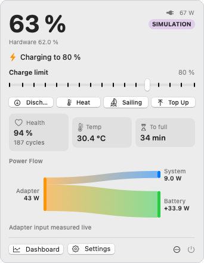
  &nbsp;
  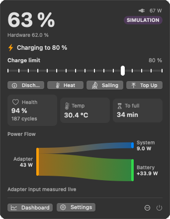
</p>

**Dashboard**: Power Flow, apps using significant energy and battery stats

<picture>
  <source media="(prefers-color-scheme: dark)" srcset="docs/screenshots/dashboard-dark.png">
  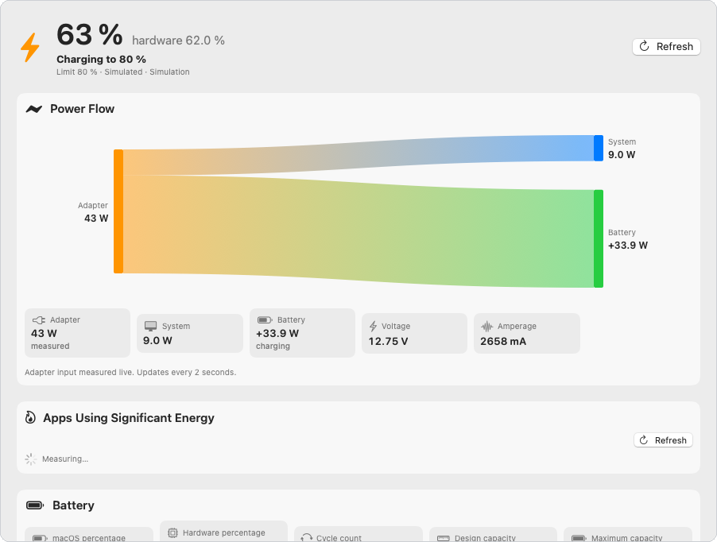
</picture>

**Settings**

<table>
  <tr>
    <td width="50%">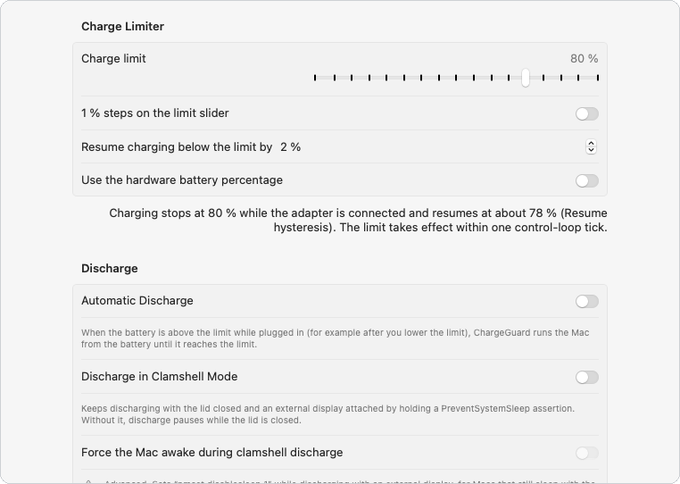<br><sub>Charge Limiter and Discharge</sub></td>
    <td width="50%">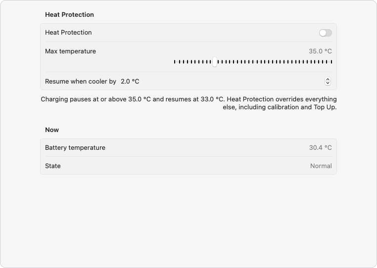<br><sub>Heat Protection</sub></td>
  </tr>
  <tr>
    <td width="50%">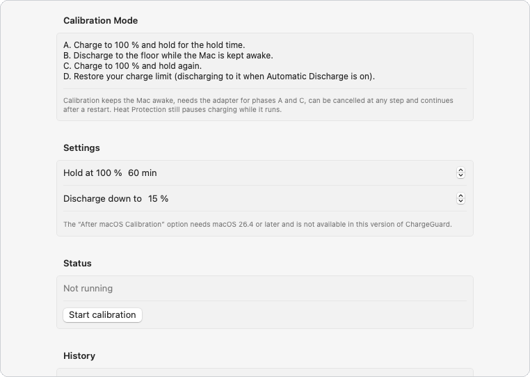<br><sub>Calibration Mode</sub></td>
    <td width="50%">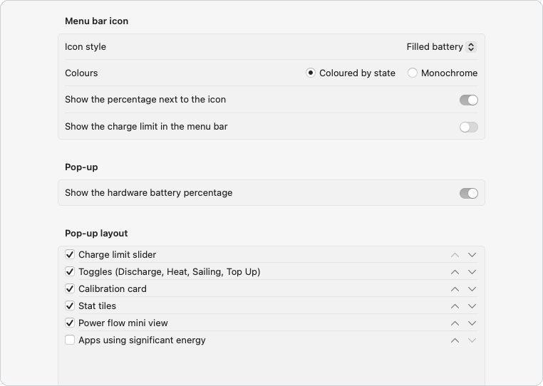<br><sub>Menu bar icon and pop-up layout</sub></td>
  </tr>
</table>

**First run**: what the helper does, before anything is installed

<p align="center">
  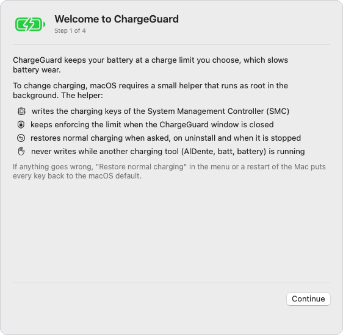
</p>

<details>
<summary><b>Every status icon</b>: 12 states in three styles, monochrome and coloured</summary>

<p align="center">
  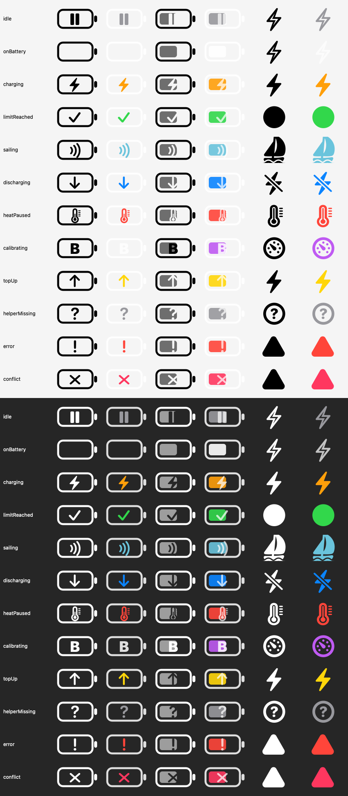
</p>

</details>

## License and credits

MIT, see [`LICENSE`](LICENSE). ChargeGuard adapts code from SMCKit (MIT) and the SMC key table from
actuallymentor/battery (MIT), and uses facts learned from reading batt (GPL-2.0, no code copied). Details
and full license texts are in [`THIRD_PARTY_NOTICES.md`](THIRD_PARTY_NOTICES.md).

ChargeGuard is an original, clean-room implementation of the AlDente Free and Pro feature set. It is not
affiliated with AppHouseKitchen. The website lives in
[amir-codes/chargeguard-website](https://github.com/amir-codes/chargeguard-website).
